# PokerNow Tracker

**Still in development and being tested by friends. Planned for the Chrome Web Store
in the coming weeks.**

PokerNow Tracker records every hand you play on PokerNow and remembers every
opponent, even across renames and devices. While a hand is being played, a side
panel shows what the player to act has shown up with *in this exact spot*: how often
they fold to a flop c-bet, and whether their calls are value, draws or air. When the
session ends, it goes through every hand you played and pulls out each one worth a
second look (missed bluffs, missed value, failed bluffs, suckouts and coolers), each
with the cards, the board, the bet sizes and the opponent's archetype and showdown
rate beside it, next to the hands you flagged or tagged yourself at the table.

Other PokerNow HUDs show you a VPIP number. This shows you the spot.

| | Similar PokerNow HUD Extensions | PokerNow Tracker |
|---|:-:|:-:|
| Live hand capture that follows each decision as it happens | – | ✓ |
| This session's stats beside lifetime | – | ✓ |
| Pick your HUD's stats, from 42 | – | ✓ |
| Hand review: missed bluffs, missed value, bad beats | – | ✓ |
| Flag and tag hands from the HUD while you play | – | ✓ |
| Aggregate stats across every game you've played | – | ✓ |
| Range charts from showdowns, in any spot | – | ✓ |
| Estimated ranges from preflop frequencies, broken down on any board | – | ✓ |
| A spot tree: every decision a player reached and what they chose | – | ✓ |
| Any spot grouped by position, pot type or holding, with bb/100 against folding | – | ✓ |
| Timing tells: what a snap and a long think have meant | – | ✓ |
| Your own tendencies, as an opponent's HUD sees them | – | ✓ |
| One player across renames and devices | – | ✓ |

Everything runs locally: a small server on your machine, a SQLite database, and a
Chrome extension. [Setup](#setup) is one command.

---

## Features

### Live HUD that follows the hand

The HUD sits in Chrome's side panel, beside the table and never on top of it. You can also
set it to float as a box on the page you can drag around (⚙ → HUD). As the
hand is played, it tracks each player's spot as it builds (`BTN open → faced 3-bet →
called → faced small flop c-bet`) and shows what they have shown up with there:

```
facing flop c-bet → call · value 50% · draw 25% · air 25% (4 of 9 shown)
```

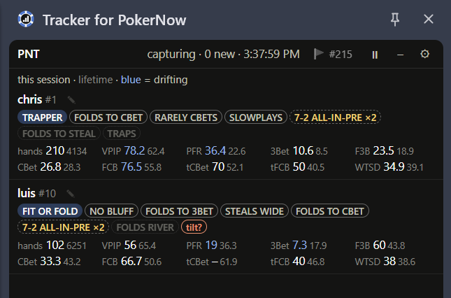

The range chart underneath follows the player to act and updates within about a
second of each action. If a spot has no history yet, it widens step by step to the
nearest one that does, and says so with **≈**. The player to act has a running
clock beside their name, a **tilt?** chip marks anyone just after a big loss, and
**🚩 #N** in the header flags the hand that just ended for review. The – button
strips it down to one table:

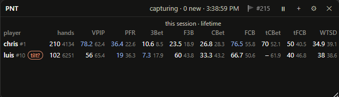

**Choose the stats.** Tick up to 12 of 42 under **HUD stats** on the front page:
steals, squeezes, check-raises, probes, floats, every street's c-bet and fold to
c-bet, W$SD, bb/100. ↑ ↓ set the order, and the cards and the compact table pick
them up on the next refresh.

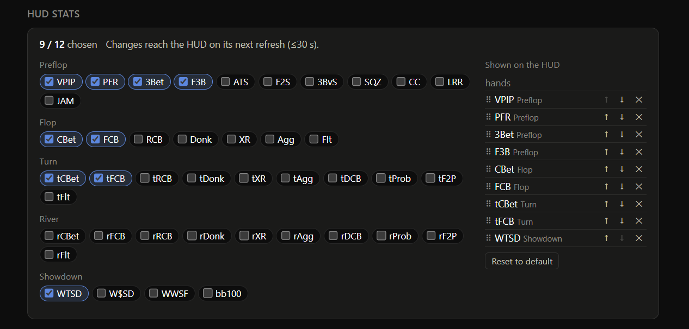

[More in the guide →](docs/guide.md#the-live-hud)

### Session vs lifetime, side by side

Every HUD figure appears twice: tonight first, with lifetime in grey beside it. When
a regular is playing ten points looser than usual, the number turns blue, so you see
it while it's happening rather than in next week's review. It only turns blue when
the gap is bigger than tonight's sample could give by chance; hover for both
samples and their 95% ranges.

### Exploit tags

The tracker turns a player's numbers into plain advice, with the count behind every
claim, judged against the rest of the table:

```
henry  FISH  11697 hands
  FOLDS RIVER            53.4% of 1787  Folded to a river bet 53.4% of the time (954 of 1787; pool 38.8%). Bet the river.
  INELASTIC VS 3BET       9.6% of 375   Opened and folded to a 3-bet only 9.6% of the time (36 of 375; pool 21.7%). 3-bet for value only, and bigger.
  LIMP-RERAISE = STRONG  68.4% of 19    Limp-reraised with a top-15% hand 13 of 19 shown times (68.4%). Fold to their limp-reraise without a big hand.
  DONKS                  29.8% of 2259  Led into the aggressor on 29.8% of flops (674 of 2259; pool 20.9%). Expect leads; raise them.
  7-2 ALL-IN-PRE ×2       100% of 2     Jammed preflop with 7-2 2 times (shown), raised it 8 times in all.
  (4BETS LIGHT)           9.2% of 76    one session only: gone without the 158-hand game pglzFVbBserr08eucOqQP7K7d (52 sessions in all)
```

Each player gets an archetype (FISH, MANIAC, STATION, LAG, NIT, or what their habits
say: STICKY, FIT OR FOLD, TRAPPER, GAMBLER), judged against what's normal at that
table size. The exploit tags cover the whole hand: STEALS WIDE, FOLDS TO 3BET,
FOLDS TO CBET, RARELY CBETS, DONKS, SLOWPLAYS, CHECKS BACK WEAK, CALLS DOWN LIGHT,
NO BLUFF, JAMS LIGHT and more. Tags that only one wild session supports are kept
apart in brackets, and a tag with too small a sample stays silent. The tags also
show as chips in the HUD, and clicking one opens the hands behind it. `pnt tags` ·
[guide](docs/guide.md#tags)

**Tendencies** turns the same rules on you: the tags an opponent's HUD would show
on you and how they would play you, then the exploits most common across your
regulars, each linking to their hands.

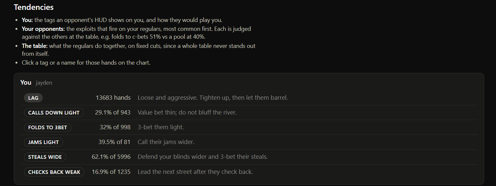

[guide](docs/guide.md#tendencies)

### Hand review

After a session, the tracker lists the hands you should look at again: missed
bluffs, missed value, failed bluffs, suckouts and coolers. Each row comes with the
context needed to judge it:

```
x #267  Missed bluff     pot   20bb  20bb pot checked down on the river: K-high vs K-high (henry)
    | he checks back every king here -- bet 1/3 and he folds everything worse
  #85   Postflop cooler  pot  166bb  set into set (harry) on the flop, all in on the flop, 4% to win, lost 81bb
```

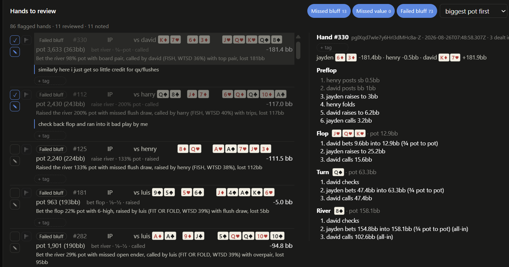

Tick hands off as you go, and write a note on any hand. The note shows up next time
the hand comes up. Click any row to replay it, or turn on **Side by side** and step
through with ↑ ↓.

**Mark hands live, too.** The rules only catch some mistakes, so when a hand feels
wrong at the table, press **🚩** in the HUD as soon as it ends. Every hand row and
replay also has a **+ tag** box (`river-bluff`, `cooler`, `study`). Flagged hands
and each tag get their own list on the chart's **Tagged** tab, `tag=cooler` works in
any filter, and the **Session** view lists every hand of a game in order so nothing
is skipped. `pnt review <you>` · [guide](docs/guide.md#hand-review)

### Range charts for any spot

Ask "what does chris raise the river with when he didn't raise preflop?" and get a
13×13 chart or a made-hand breakdown built from his showdowns, with coverage stated
up front, so you know how much of the range is missing:

```bash
pnt range chris --filter "raised_bet_river,!pfa" --by made
```

```
hands in this spot: 43   cards known: 18   coverage: 41.9%

class                       n    pct  won   net bb
quads                       1    5.6    1    143.2
full_house                  5   27.8    4   -138.1
flush                       1    5.6    1     26.5
straight                    4   22.2    3    255.4
set                         2   11.1    2     66.5
trips                       2   11.1    2     51.0
two_pair                    2   11.1    2     53.0
top_pair                    1    5.6    1      5.0
```

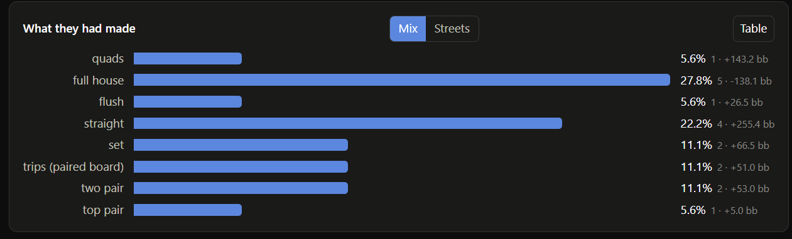

17 of the 18 he showed were two pair or better, and not one was a draw or air: fold
one pair to it. The 25 that were never shown are the raises that got a fold, so
that's where any bluffs would be.

A spot can be anything: position, pot type, preflop line, bet size bucket, facing a
jam, board texture, pot size, timing, or who you were against. Filters take *and*
(`,`), *or* (`|`), brackets and `!( )`: `position=BTN|CO,3bet_pot|4bet_pot`. Every
chip shows how many hands it would leave before you click it, and ★ saves a spot
under a name. Sizing views show what each bet size is made of, and every cell opens
the hands behind it with a replay. [Filter reference →](docs/guide.md#filters)

### Spot tree and Group by

The **Tree** view is every spot a player reached, seat first, with what they chose
there. Click a spot, or one colour of its bar, and its exact filter goes into the
Spot box: `BTN → facing open → call` is one click, not a filter to write.

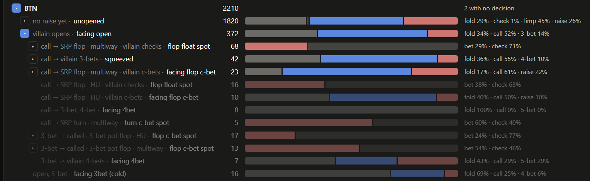
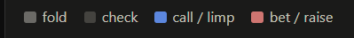

**Group by** splits any spot into rows (position, pot type, flop holding, and a
second split under it), each with hands, shown, net bb and bb/100, and on the blinds **vs folding
all**: bb/100 against folding every blind. Henry's big blind is −107 bb/100 raw, and vs fold
says whether that's a leak or just the blind. **Pool** swaps in everyone's hands, and
clicking a row narrows the spot to it.

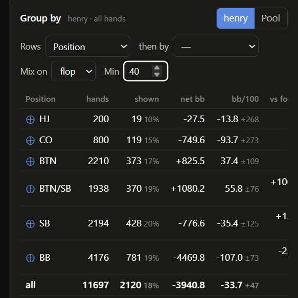

**Made hands › Streets** shows how flop holdings turned into river holdings, and for
your own hands, where each flop holding ended up. [guide](docs/guide.md#the-chart-page)

### Estimated ranges

Showdowns miss the hands that folded. **Estimate** fills that gap from frequencies:
henry opens 25.7% of the time from the button (`position=BTN,unopened=raise`), so the
chart fades everything outside the top 25.7%, adjusted by what he has actually shown
(here, more suited gappers and connectors).

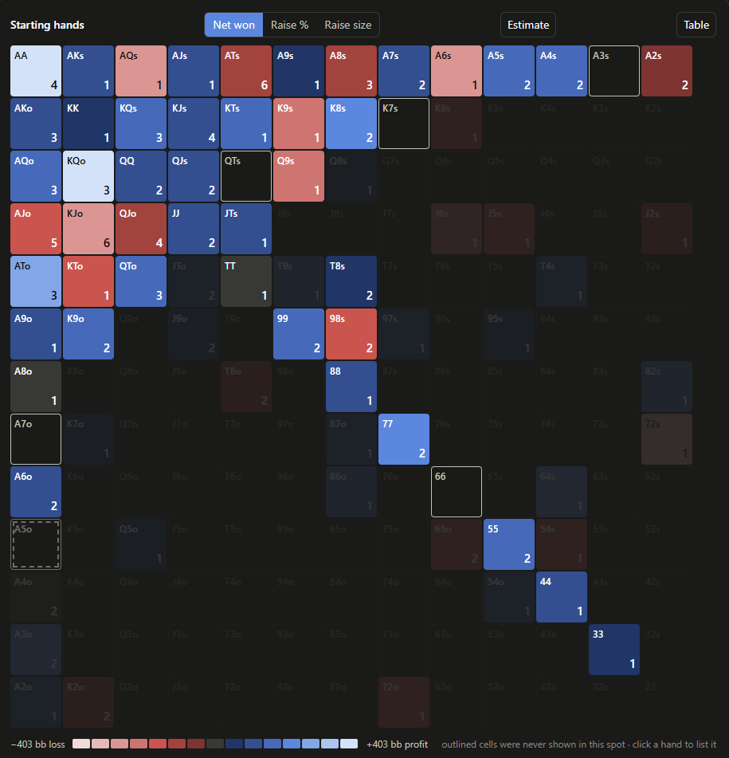

**Board** puts that range on a flop and cuts it at his next action's rate. On
`Ah7c2d` he c-bets 42.5%: betting only his best hands would be 100% value, but what
he showed after c-betting was 22% draws and air, so he c-bets this board much
lighter than his value.

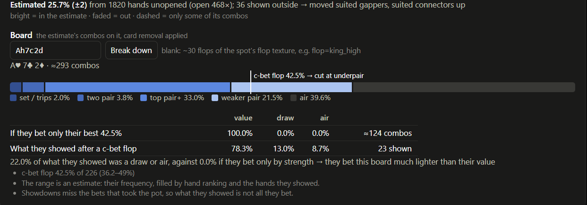

[guide](docs/guide.md#estimated-ranges)

### Timing tells

Every decision is timed from the action before it: pre-selected, snap, normal or
tank. Looking at data from my friends, a river bet after a long think (over 5 s) was value
58.9% of the time, and a snapped one 26.1%. A turn call after a tank was value 49.1% of the
time, against 16.2% for a pre-selected one. River calls carry little signal.

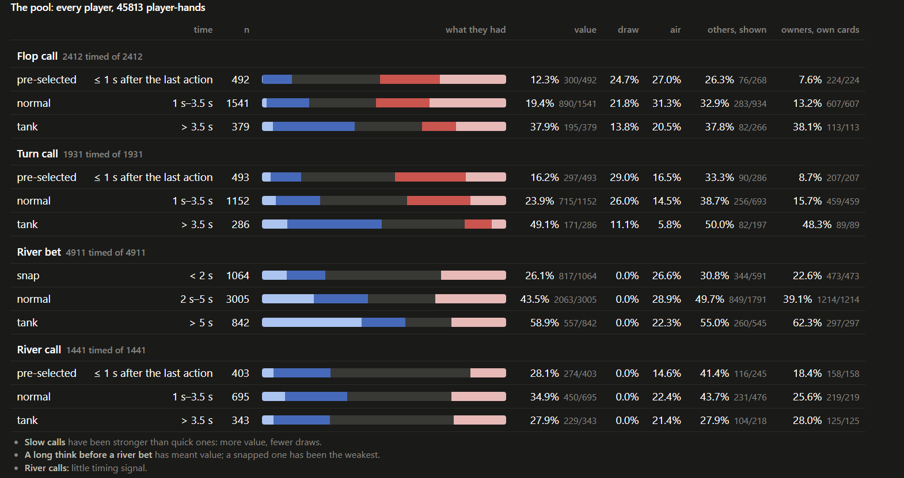

Each player's own table sits underneath, and `think_river>=5` or `tempo_river=tank`
work in any filter. `pnt timing <player>` · [guide](docs/guide.md#timing-tells)

### All-in EV

The tracker separates luck from play. For every all-in showdown, it compares what
each player won with what their equity was worth, and splits the luck by the street
the money went in:

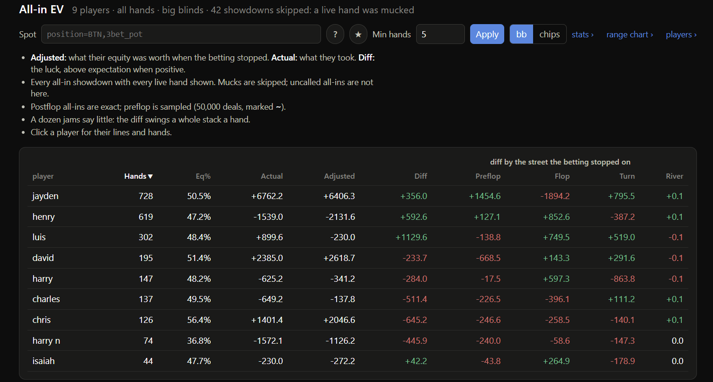

Luis is +900bb on his all-ins, but by equity he'd be down 230bb: the deck gave him
1,130bb. Chris gets it in ahead (56% equity on average) and is 645bb short of what
that was worth. Click a player to draw their actual and adjusted lines over time:

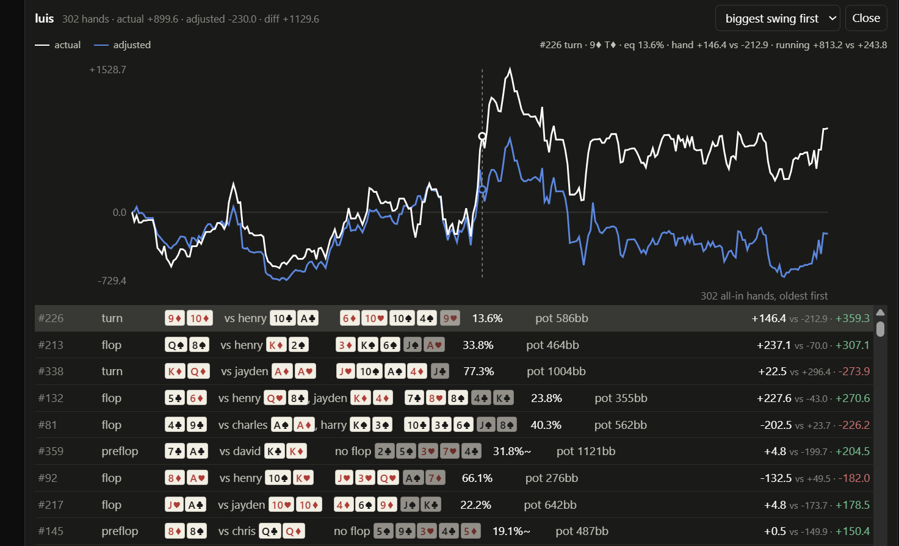

`pnt allin` · [guide](docs/guide.md#all-in-ev)

### Biggest pots

The pots that mattered tonight (24h), this week, this month or ever, from everyone at
the table, sized against each other so the outliers stand out, with one click to
replay:

```
 12,872   322bb  2026-10-16T02:57 jayden +7,556 vs luis -5,316      Qc 5s 8c 2c Jc
 10,806   270bb  2026-10-16T03:43 luis +5,473 vs henry -5,333       Kc 3s 3d 6s Ts
  7,920   198bb  2026-10-16T03:20 luis +4,280 vs jayden -3,640      4h Jd Qd 4s 3h
```

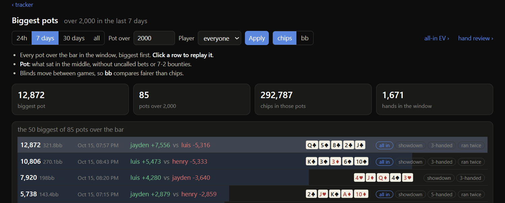

Narrow it to one player or one game. `pnt pots` · `pnt pots --all` ·
`pnt pots --game <id>` · [guide](docs/guide.md#biggest-pots)

### Stats across every game you've played

VPIP, PFR, 3-bet, c-bet, WTSD, bb/100 and more for every player, across every game,
in one sortable table, with **All stats** for squeeze, cold call, the blind war,
probes and floats. Hover any rate for its sample and 95% range. Split any player by
position, players on the flop, straddle or stack depth; the position split adds **vs
fold** on the blinds, so a big blind losing less than folding would isn't flagged as
a leak. Narrow everything to any spot (`pnt stats --filter "faced_cbet_flop,players>=3"`).
An empty sample shows `--`, never a misleading `0%`. `pnt stats` ·
`pnt positions <player>` · [guide](docs/guide.md#stats)

### One player, many names

PokerNow gives the same person a new ID on every device, and players rename
constantly. The players page shows every name each ID has used, so you can merge
the ones you recognise:

```
harry    <-  bread, Woolball (har), wool, wool ball, fish
```

Before you confirm a merge, the page shows exactly what it will move, and every
merge can be undone. [guide](docs/guide.md#players-and-aliases)

### And more

- **Player notes** that follow the person across devices and show in the HUD.
  [guide](docs/guide.md#player-notes)
- **Head to head**: the big blinds that went between you and each opponent.
  [guide](docs/guide.md#head-to-head)
- **Red line, blue line**: winnings without showdown and at showdown, with each
  session's result. [guide](docs/guide.md#the-chart-page)
- **Shows**: the hands a player turned over without being asked, and whether the
  fold they showed was ahead. [guide](docs/guide.md#shows-without-being-asked)
- **7-2 bounties**: the side bet's leaderboard. [guide](docs/guide.md#7-2-bounties)
- **Your leaks** (experimental): your stats furthest outside ordinary values,
  ranked by cost. `pnt leaks` · [guide](docs/guide.md#your-leaks-experimental)

### Your log folder is the database

Drop an export in the folder and it's imported. Delete one and the game is removed.
Live capture writes every game you play there automatically, and `pnt backfill`
fetches old games by link, so the folder is a complete, portable record of your
games. Switch the database or the log folder under **Files** on the front page: it
takes effect at once, for the HUD too, and every later start and `pnt` command uses
the same one. A database copied from another PC works as is.

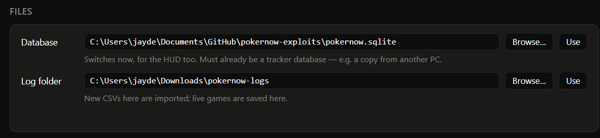

[guide](docs/guide.md#getting-hands-in)

### Share logs safely

A raw PokerNow export reveals your hole cards on every hand, including the ones you
folded. `pnt redact` writes copies that keep only the cards the table already saw,
and `--audit` checks a folder before you commit it.
[guide](docs/guide.md#publishing-logs)

---

## Setup

You need **Python 3.11+**, **pipx** and **Chrome**. If you have Python but not
pipx, run `python -m pip install --user pipx` and then `python -m pipx ensurepath`,
and open a new terminal. On Windows, use the python.org installer rather than the
Microsoft Store build, which sandboxes the files a background server needs.

```bash
pipx install https://github.com/Jaaaayden/pokernow-tracker/archive/refs/heads/main.zip
pnt setup
```

`pnt setup` handles the whole first run and is safe to re-run. It creates the
database, imports any exports it finds, installs the always-on background server on Windows
and macOS, and prints the extension folder. A new database starts empty;
`pnt setup --sample` fills it with a 16k-hand anonymized sample to try things on.

1. In Chrome, go to `chrome://extensions`, turn on **Developer mode**, click **Load
   unpacked**, and pick the folder `pnt setup` printed. `pnt extension --open`
   reveals it again later.
2. Pin the extension, open a PokerNow game, and click the icon to open the side
   panel.
3. Open **<http://127.0.0.1:52000>** for everything else: stats, charts, review,
   tendencies, pots, players and settings.

On Windows and macOS the server starts at every login and restarts itself if it
crashes. On Linux, run `pnt serve` yourself, or put it under systemd. On macOS, if
it asks whether Python may use your Downloads folder, allow it: that is where the
logs live.

### Updating

```bash
pnt update
```

This stops the background server, reinstalls from wherever you installed from, and
starts the server again on the new code. When the new version reads hands
differently, the restart re-reads your stored logs while the server is down
(`pnt rebuild --if-stale`), so nothing is left to run by hand. Without the
background server (Linux, or
a `pnt serve` in a terminal) it only reinstalls, then tells you to restart
`pnt serve`. The extension notices the new files and reloads itself within a minute
of the new server starting. If you use the side panel, Chrome closes it when the
extension reloads, so click the icon to open it again.

Some updates change what is stored for each hand. When the restart (or the new `pnt serve`) says so, run
`pnt rebuild` once: it re-reads every stored log, so nothing needs importing
again. The update that added think times (the chart's **Timing** view) is one.

On a Mac set up before the background server came to macOS, run `pnt service
install --db <full path to pokernow.sqlite>` once to get it.

On Windows, run `pnt service install` once after this update: the background
server now runs at normal priority, so HUD answers no longer queue behind the
browser. `pnt update` keeps the task as it was installed.

Installed before `pnt update` existed? Update by hand this one time, then reload
the extension at `chrome://extensions`:

```bash
pnt service stop
pipx install --force https://github.com/Jaaaayden/pokernow-tracker/archive/refs/heads/main.zip
pnt service start
```

### Commands

```bash
pnt import                                   # every log in the log folder
pnt import path/to/log.csv                   # or specific files, a folder, or a glob
pnt sync                                     # match the log folder: new logs in, deleted logs out
pnt backfill -f links.txt                    # download old games by link into the log folder
pnt stats                                    # every player, most hands first
pnt stats --filter "tag=cooler"              # any spot, including hands you tagged
pnt positions genericpoker                   # one player, split by position
pnt range chris --filter "raised_bet_river"  # what they had in a spot
pnt sizing henry --street flop --kind cbet   # what each bet size is made of
pnt tags                                     # archetype and exploit tags
pnt tags henry --filter "players>=4"         # judged on the hands in a spot
pnt review jayden                            # hands to review
pnt note <game_id> 161 "turn barrel was bad" # write down what went wrong in one hand
pnt player-note henry "jams light"           # and what you know about a player
pnt allin                                    # all-in EV: actual vs adjusted
pnt timing henry                             # what their snap, normal and tank decisions held
pnt pots                                     # biggest pots in the last 7 days
pnt winnings henry                           # red line, blue line, and each session
pnt h2h henry                                # money between henry and each opponent
pnt shows henry                              # what they showed without being asked
pnt bounties                                 # the 7-2 leaderboard
pnt leaks                                    # your own leaks (experimental)
pnt hero Sam                                 # who "you" are, if the guess is wrong
pnt alias list                               # the player names you can query
pnt alias merge onlybluffs genericpoker      # one person, two devices
pnt redact --out pnt/logs                    # copies you can publish
pnt where                                    # which database, log folder and extension, and why
pnt update                                   # the latest code; the extension follows on its own
```

Commands that take a player take an **alias** from `pnt alias list`. The log folder
defaults to `~/Downloads/pokernow-logs`; change it under *Files* on the front page, or
set `PNT_LOG_DIR`, which wins over the page. The database chosen there is the one
every command uses too, from any folder; `--db` still overrides it.

| Background server (Windows, macOS) | |
|---|---|
| `pnt service status` | Whether it's up, and which database it has open |
| `pnt service restart` | Run after `git pull` in a checkout (`pnt update` restarts it for you). Rebuilds stored hands first when the new code reads them differently. If an old server still holds the port, it names the process to end |
| `pnt service log` | The last lines of `~\.pnt\server.log` |
| `pnt service stop` / `start` | Stop until the next login, or start again |
| `pnt service uninstall` | Remove it; the database is untouched |

### Under the hood

The server at `127.0.0.1:52000` answers every page and the HUD from one JSON API,
which your own scripts can read too. The choice of database and log folder lives in
`~/.pnt/config.json`, outside the database, so the background task, `pnt serve` and
the CLI all open the same one. Routes added in this round:

| Route | Returns |
|---|---|
| `GET` / `PUT /settings/hud` | The HUD's chosen stats, from the catalog of 42 |
| `GET` / `PUT /settings/paths`, `POST /settings/paths/browse` | The database and log folder in use; switch either, or open the system picker |
| `GET /groupby` | A spot split into rows, for one player or the pool, each with the filter that reproduces it |
| `POST /counts` | How many hands each candidate filter term would leave |
| `GET /players/{alias}/tree` | The spot tree, each node with its decision mix and filter |
| `GET /players/{alias}/streets` | Flop holding against river holding |
| `GET /players/{alias}/estimate`, `/board` | The estimated range, and its breakdown on a board |
| `GET /tendencies`, `GET /leaks` | Your tags as others see them, the regulars' common tags, your leaks |
| `GET /players/{alias}/timing`, `GET /timing` | Timing tells, for one player or the pool |
| `GET` / `POST /spots`, `DELETE /spots/{id}` | Saved spots |
| `GET /tags`, `GET /tagged`, `/games/{game}/hands/{n}/tags` | Hand tags: list, find, add, remove |

Filters also gained `|`, brackets, `!( )`, value lists and `tag=`, everywhere a
filter is taken. [architecture.md](docs/architecture.md) has the rest.

### Documentation

| File | Contents |
|---|---|
| [`docs/guide.md`](docs/guide.md) | The full reference for every feature: filters, the HUD, tags, review, sync rules |
| [`docs/architecture.md`](docs/architecture.md) | How it works inside: design, parser rules, live capture, the background server, tests |
| [`docs/privacy.md`](docs/privacy.md) | What is stored, where it goes, and what each extension permission is for |
| [`docs/findings.md`](docs/findings.md) | The PokerNow log format: identity, ordering, amounts, line vocabulary, traps |
| [`pnt/stats/SPEC.md`](pnt/stats/SPEC.md) | Every stat, tag and review flag, defined exactly |
| [`docs/ideas.md`](docs/ideas.md) | Analysis not built yet, ranked by value per effort, with the data each would use |
| [`tests/fixtures/README.md`](tests/fixtures/README.md) | What each fixture log exercises |
| [`pnt/logs/README.md`](pnt/logs/README.md) | The bundled sample corpus |

### Development

```bash
git clone https://github.com/Jaaaayden/pokernow-tracker && cd pokernow-tracker
pip install -e ".[dev]"
pytest -q
```

See [architecture.md](docs/architecture.md#testing) for what the suite guarantees.
For parallel work in worktrees (Orca reads `orca.yaml`), see [AGENTS.md](AGENTS.md):
`python scripts/orca_worktree.py check` runs everything CI runs.

UI feedback without screenshots: press the **backslash** key (`\`) on any page or in the HUD
(or add `?annotate` to a URL), click the element, type what's wrong. Notes land in
`~/.pnt/annotations.json` with the element's selector and text; the `ui-feedback`
skill in `.claude/skills/` works through them and replies on each one.
